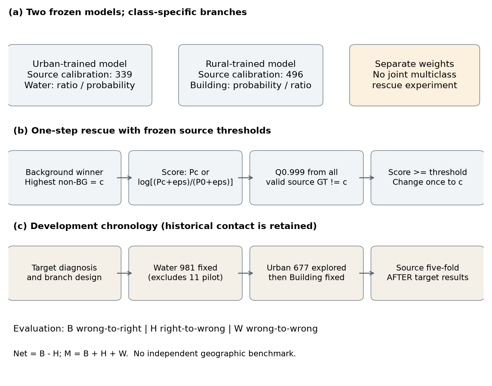
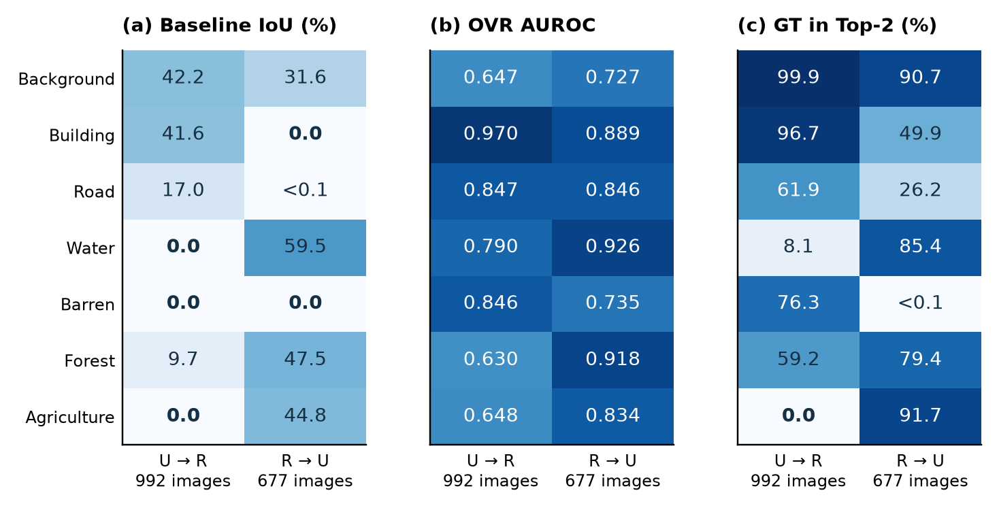
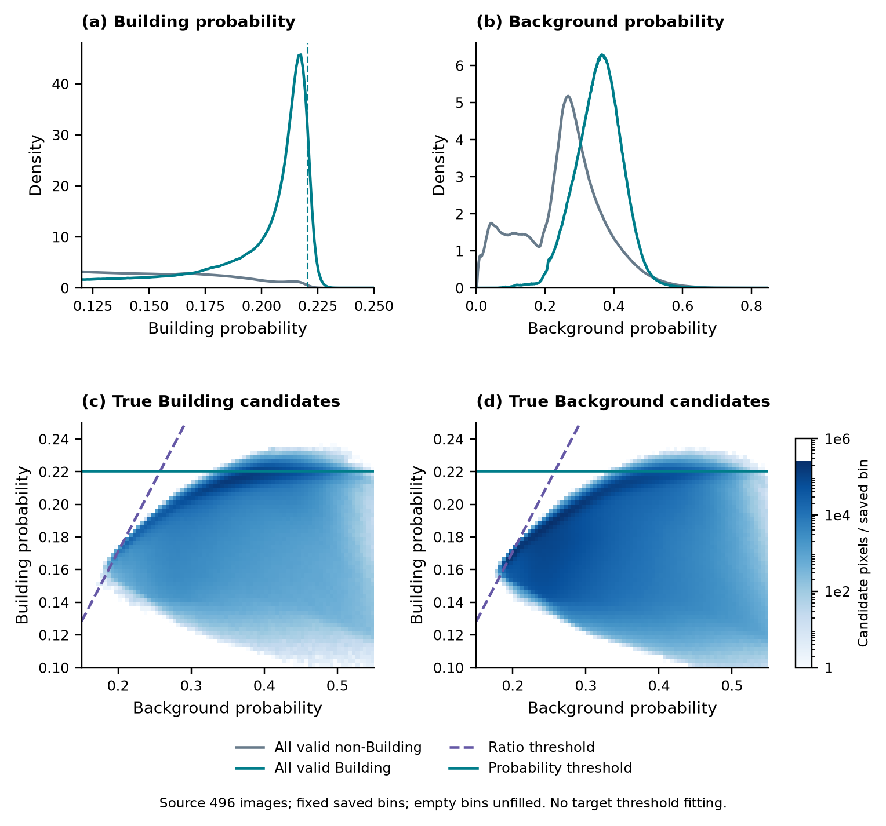
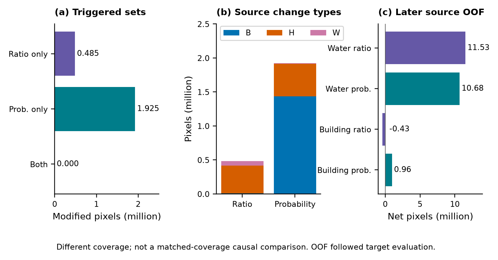
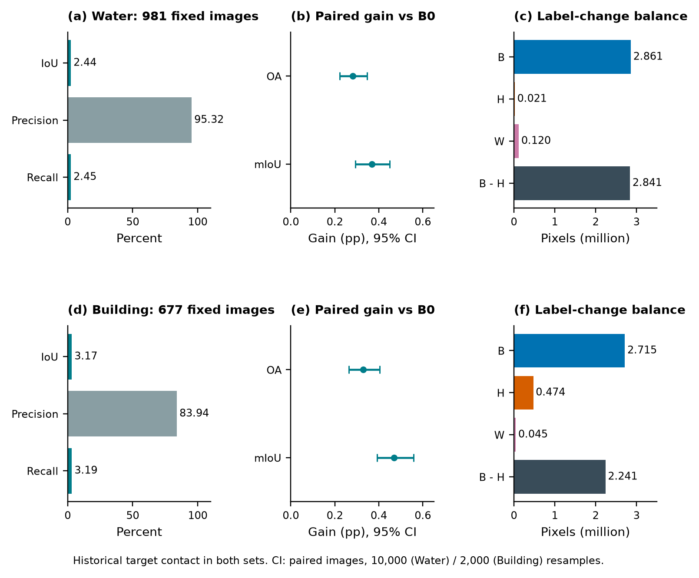

# Class-wise Probability Rescue for Cross-Domain Remote Sensing Segmentation

[中文说明](README.zh-CN.md) · [Method](docs/methodology.md) · [Reproduction](docs/reproduction.md)

Diagnose missing class predictions in cross-domain segmentation and recover a limited subset using source-calibrated probability rules on frozen ResNet18–UNet outputs.

## Results at a glance

| Transfer | Rescued class | Images | Class IoU (%) | Precision (%) | Recall (%) | mIoU (%) | Net pixels (B−H) |
|---|---|---:|---:|---:|---:|---:|---:|
| Urban → Rural | Water | 981 | 0 → **2.4441** | **95.3211** | 2.4471 | 15.8135 → **16.1818** | **2,840,590** |
| Rural → Urban | Building | 677 | 0 → **3.1684** | **83.9389** | 3.1878 | 26.1913 → **26.6607** | **2,240,851** |

The rule adds high-precision predictions but recall remains low: it is a selective output correction, not complete class recovery. Results are based on the documented LoveDA development and evaluation workflow; they are not presented as a newly held-out geographic benchmark.

## Research highlights

- **Bidirectional transfer:** separate Urban-trained and Rural-trained models with a common seven-class label system.
- **Class-specific failure diagnosis:** compare argmax outputs, one-vs-rest probability ranking and true-class Top-2 coverage.
- **Probability rescue:** change only background predictions whose strongest non-background candidate passes a source negative-pool quantile threshold.
- **Score ablation:** compare class probability with class/background probability ratio; retain the harmful Building ratio control.
- **Source five-fold analysis:** recalibrate thresholds on four image folds, evaluate on the fifth, without retraining weights.
- **Spatial accountability:** decompose label changes into beneficial B, harmful H and wrong-to-wrong W, with M=B+H+W.
- **Runnable research tools:** synthetic verification, frozen configs, pooled metrics and statistical figure regeneration.

## Method overview



For class c, eligible pixels satisfy `argmax(P)=Background` and `argmax(P[1:])=c`. The score is either `P[c]` or `ln((P[c]+1e-8)/(P[0]+1e-8))`. The source threshold is the linear 0.999 quantile over **all valid GT != c pixels**, not only candidate negatives. Apply one simultaneous update; all other labels remain unchanged.

## Visual evidence









Building ratio loses 398,085 net pixels on the source calibration set; probability gains 954,488. Later source OOF net totals are −426,417 and +964,630. Both Water scores have positive OOF net totals. These comparisons have different modification coverage and do not establish a matched-coverage causal effect.

## Quick start — no LoveDA or weights

```bash
git clone https://github.com/xy0125423/loveda-classwise-probability-rescue.git
cd loveda-classwise-probability-rescue
python -m venv .venv
# Activate the environment using your shell's usual command.
python -m pip install -e .
python examples/synthetic_demo.py --output outputs/demo
python -m unittest discover -s tests -v
```

The demo creates only synthetic arrays and writes a status image and metrics. Expected counts: **B=2, H=2, W=2, M=6, net=0**. The base install needs no PyTorch. Add `python -m pip install -e ".[full,dev]"` for model commands and optional pytest.

## Full reproduction

Follow [the executable command sequence](docs/reproduction.md): obtain data and official encoder initialization locally, validate frozen splits, train each source model, infer source calibration and target probabilities, check thresholds, apply the frozen branches, export metrics and run source five-fold evaluation.

**Validation status:** the synthetic path, unit tests, imports, command help and saved-statistic redraw were executed for this release. Full LoveDA training/inference was **not rerun** during packaging. Reorganized entry points preserve extracted historical kernels, but a newly installed environment is not claimed to reproduce every historical pixel or training trajectory. [Protocol and environment details](docs/experiments.md).

Redraw all five figures using packaged aggregate statistics:

```bash
python scripts/reproduce_figures.py --output outputs/figures
```

This redraw is independent of raw data and checkpoints; it does **not** reproduce the segmentation models.

## Dataset

Obtain LoveDA from the [official repository](https://github.com/Junjue-Wang/LoveDA), [Zenodo record](https://doi.org/10.5281/zenodo.5706578), or [project page](https://rsidea.whu.edu.cn/LoveDA.htm). Follow the official academic-use terms. See [directory layout and label mapping](docs/dataset.md). No original images, GT, image crops, weights or probability caches are included here.

## Citation, references and license

Author: **Mengle Xue**, an undergraduate student in remote sensing in Guangxi, China. Contact: **rsdyxjh558@gmail.com**.

Use [CITATION.cff](CITATION.cff) for software citation. Cite the [LoveDA paper](https://datasets-benchmarks-proceedings.neurips.cc/paper/2021/hash/4e732ced3463d06de0ca9a15b6153677-Abstract-round2.html) when using its data. [Key literature and positioning](docs/references.md) · [BibTeX](docs/references.bib).

Project-authored code is released under the [MIT License](LICENSE). Dataset, pretrained weights and dependencies retain their own terms; see [third-party notices](docs/THIRD_PARTY_NOTICES.md).
