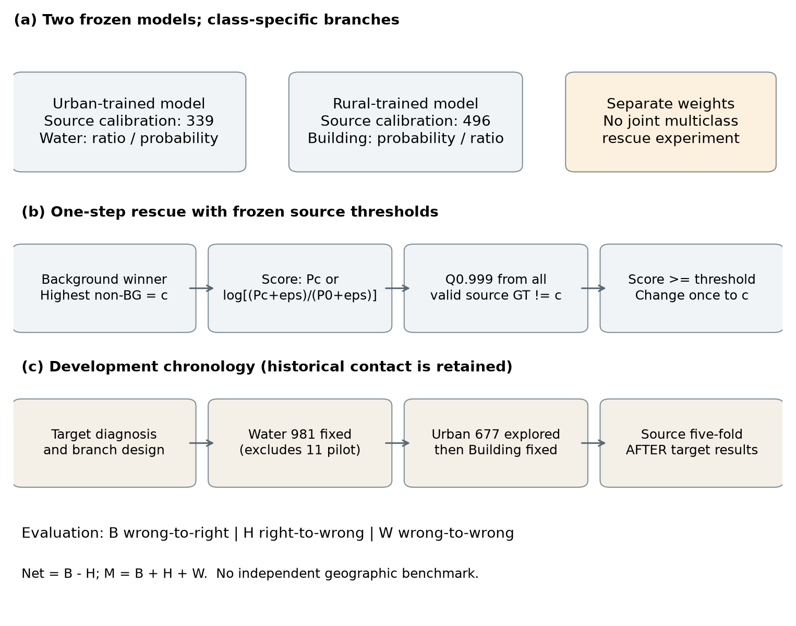
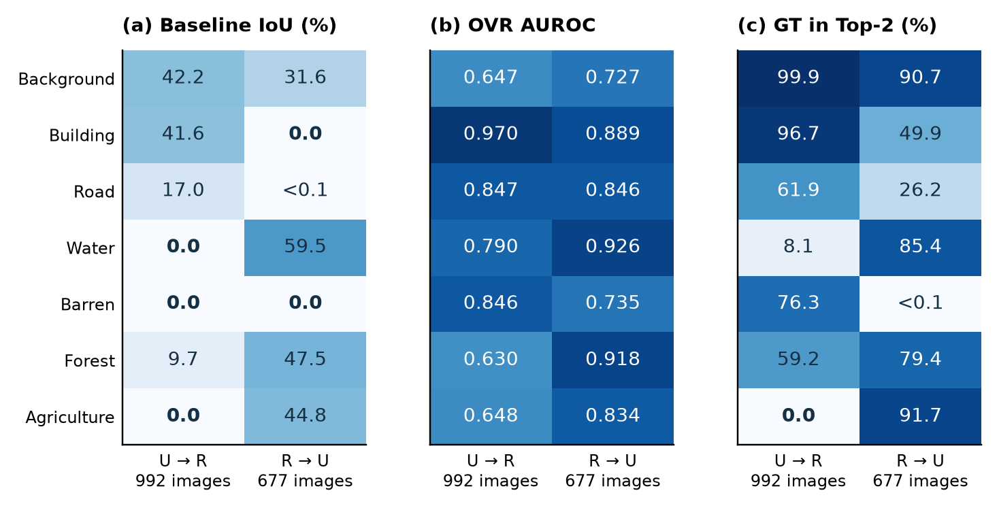
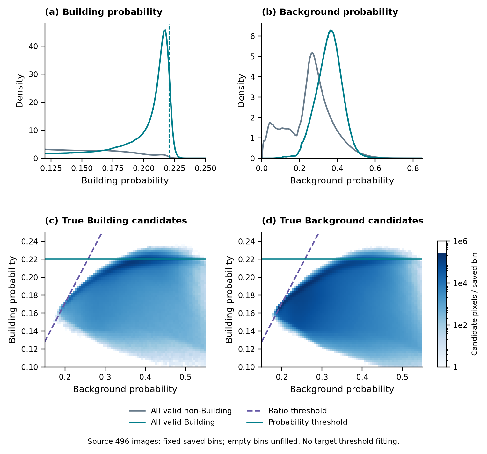
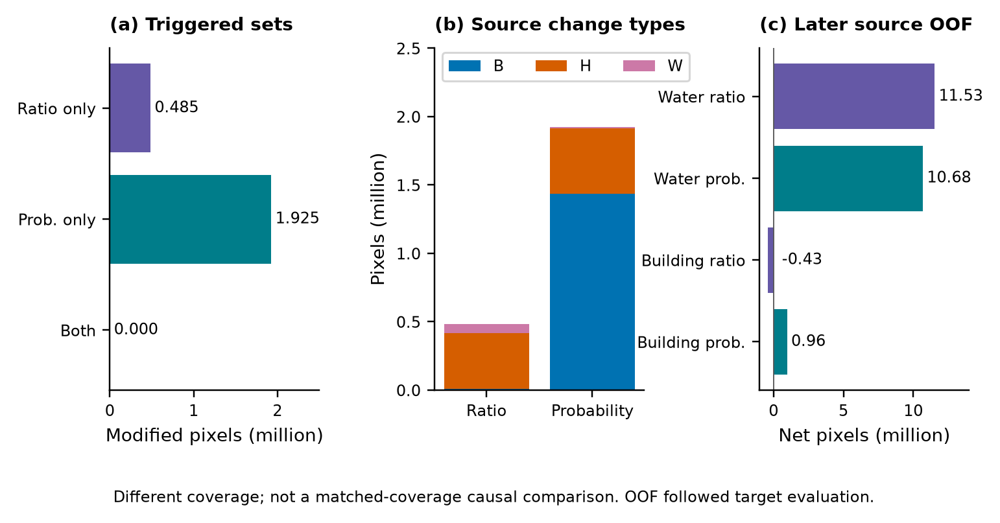
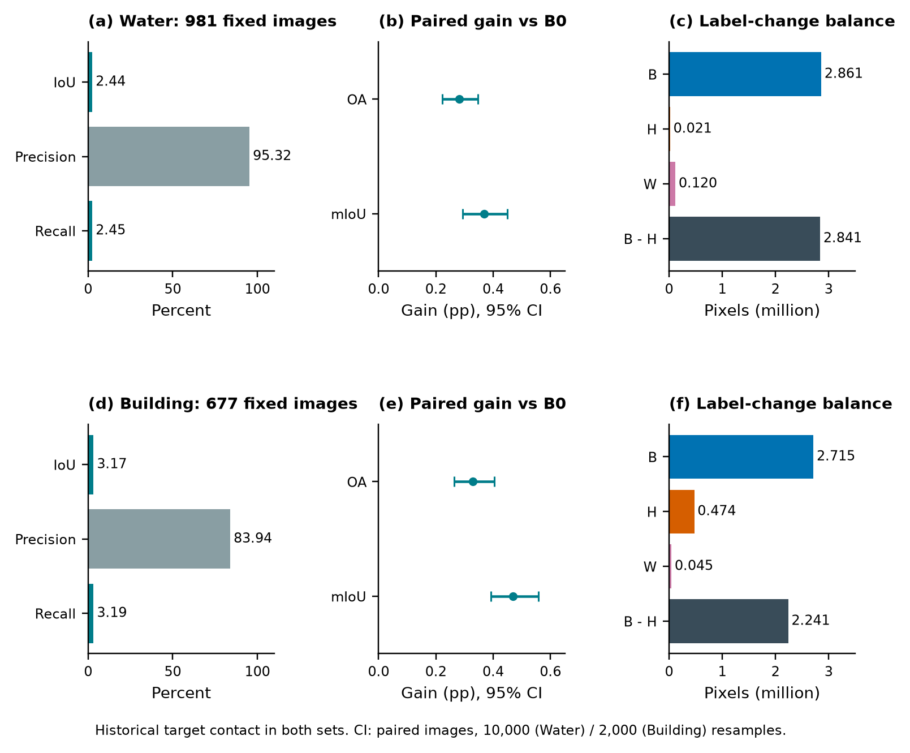

# 跨域遥感语义分割的类别条件概率救援

[English](README.md) · [方法](docs/methodology.md) · [复现步骤](docs/reproduction.md)

诊断跨域分割中的类别预测缺失，在冻结的ResNet18–UNet输出上，用源域标定的概率规则恢复有限候选像素。

## 核心结果

| Transfer | Rescued class | Images | Class IoU (%) | Precision (%) | Recall (%) | mIoU (%) | Net pixels (B−H) |
|---|---|---:|---:|---:|---:|---:|---:|
| Urban → Rural | Water | 981 | 0 → **2.4441** | **95.3211** | 2.4471 | 15.8135 → **16.1818** | **2,840,590** |
| Rural → Urban | Building | 677 | 0 → **3.1684** | **83.9389** | 3.1878 | 26.1913 → **26.6607** | **2,240,851** |

新增预测精度较高，但召回率仍低，不能解读为完整恢复类别。结果来自已记录的LoveDA开发与评价流程，不作为全新留出地域基准。

## 研究亮点

- 双向城乡迁移，两个独立训练并冻结的模型。
- 七类别输出失效、跨像素概率排序和真实类Top-2覆盖诊断。
- 原始背景与最高非背景候选约束下的单次标签救援。
- ratio与probability评分消融，保留Building ratio负结果。
- 源域五折阈值重标定与OOF评价，模型权重不重训。
- B/H/W/M标签修改损益分解，区分净收益与修改量。
- 可运行的合成验证、冻结配置、统计表及科研图件重绘。

## 方法总览



仅当原始argmax为背景、最高非背景类别为目标类c，且评分达到阈值时改为c。评分为P[c]或ln((P[c]+1e-8)/(P[0]+1e-8))。阈值来自全部有效源域GT≠c像素分数的0.999线性分位数；负池不只包含候选。同步修改一次，其余标签保留。

## 结果可视化






Building源域ratio净收益−398,085，probability为954,488；后续OOF分别为−426,417和964,630。Water两种评分OOF均为正。两评分修改覆盖不同，不能据此作同覆盖量因果解释。

## 无数据快速验证

```bash
git clone https://github.com/xy0125423/loveda-classwise-probability-rescue.git
cd loveda-classwise-probability-rescue
python -m venv .venv
# 按所用shell激活虚拟环境
python -m pip install -e .
python examples/synthetic_demo.py --output outputs/demo
python -m unittest discover -s tests -v
```

不依赖LoveDA、训练权重或PyTorch。演示仅生成合成数组与状态图，预期B=2、H=2、W=2、M=6、净收益0。运行模型命令另安装：`python -m pip install -e ".[full,dev]"`。

## 完整复现

参照[完整命令说明](docs/reproduction.md)完成官方数据获取、冻结划分核对、双向训练、源域和目标推理、源域阈值核查、固定规则评价与源域五折。发布时已运行合成流程、测试、模块导入、命令帮助及统计重绘；**没有重跑LoveDA训练或推理**，不宣称整理后的完整入口已经得到逐像素或训练轨迹等价验证。[实验协议](docs/experiments.md)。

```bash
python scripts/reproduce_figures.py --output outputs/figures
```

此命令使用已保存的汇总统计重绘全部五图，不是模型复现。

## 数据

LoveDA来自[官方GitHub](https://github.com/Junjue-Wang/LoveDA)、[Zenodo](https://doi.org/10.5281/zenodo.5706578)及[项目主页](https://rsidea.whu.edu.cn/LoveDA.htm)。按官方学术使用条款获取和使用。仓库不包含原始RGB、GT及裁剪、权重、预测栅格或概率缓存。[本地目录与标签映射](docs/dataset.md)。

## 引用与许可

唯一作者：**Mengle Xue**。身份：广西遥感本科生。联系方式：**rsdyxjh558@gmail.com**。

软件引用见[CITATION.cff](CITATION.cff)，使用LoveDA时同时引用其原论文。[参考文献与方法定位](docs/references.md)及[BibTeX](docs/references.bib)。项目原创代码采用[MIT](LICENSE)；数据、预训练权重及依赖不由本项目重新许可，见[第三方说明](docs/THIRD_PARTY_NOTICES.md)。
